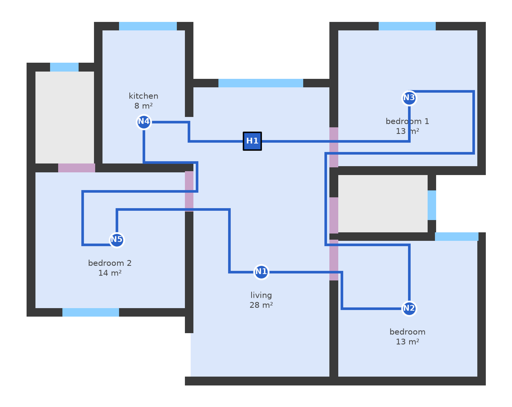
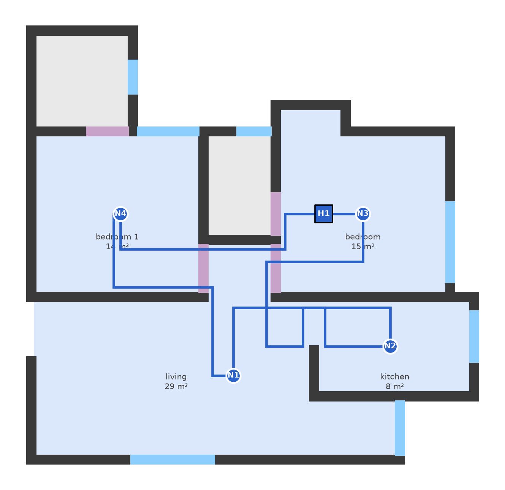

# hackhive_control_hub_loc

UR Hackathon 2026H2: joint optimisation of hub placement and closed-ring cable
routing on ResPlan floor plans. Fewest hubs wins; ties go to the lowest
J = L + 5X + O + 0.5B (cable length, crossings, overlap, bends).

**Status:** a working end-to-end model. All phases run from a ResPlan plan to
validated hubs, zones and closed cable rings. Routing still has known issues
(see below).

| Best result so far (plan 14675) | A hard case (plan 7640) |
|---|---|
|  |  |
| 1 hub wires all 5 rooms in one ring, no crossings or overlap | Legs routed one at a time cross 3 times in the kitchen |

## Results on the first 300 of the 17,000 ResPlan plans

| | |
|---|---|
| Plans passing every rule check | **280 / 285** (the other 15 have a single room over 100 m², so no valid grouping exists) |
| Hubs per plan | 1.86 on average; 71% exactly at the lower bound max(⌈A/100⌉, ⌈n/5⌉) |
| Median cost J | 45.7 |
| Median solve time | 0.11 s per plan (1.5 s worst) |

## How it works

| Phase | What it does | Algorithm | Code |
|---|---|---|---|
| 0 Read the plan | Scale to metres (√(inner.area / area)), keep living / bedroom / kitchen / storage, repair data issues, build the region cable may use, lay a non-uniform grid that is dense near doors and devices | Computational geometry (Shapely) + non-uniform axis-aligned grid | `hubring/plan.py`, `hubring/grid.py` |
| 1 Cable between devices | Cheapest route between every pair of devices, counting length and bends | Dijkstra on a (grid point, heading) state graph, so each turn costs 0.5 | `hubring/routing.py` |
| 2 Possible zones | Every connected group of rooms within 100 m² and 5 devices | Connected-subset enumeration with one bit per room | `hubring/groups.py` |
| 3 Best ring per zone | Cheapest closed loop through each zone's devices | Every visit order (≤ 12) + heading DP, then collision-aware rip-up-and-reroute with door side lanes | `hubring/loops.py`, `hubring/metrics.py` |
| 4 Hubs and final zones | Hub on the ring (≥ 0.5 m from walls, so it adds no cable), then the set of zones covering every room once | Bitmask DP (exact cover): fewest hubs, then lowest J, then most even area | `hubring/solve.py` |

`hubring/solve.py` also validates every result against the hard rules and
writes JSON (hub positions, zones, ring polylines in metres and drawing units,
metrics).

### Choices where the rules leave room
- Each ring stays inside its own zone's rooms, doors and open passages; never through bathrooms or another zone. So rings never meet and J adds up across zones.
- Hubs and devices stay ≥ 0.5 m from walls and windows.
- A one-door room is entered and left on two parallel lanes through the door, so the runs don't overlap.
- Which rooms connect is computed from the geometry, because ResPlan's stored graph sometimes links rooms through solid walls.
- Data fixes: storage drawn inside another room is cut out; a "window" between two rooms is treated as a door.

## Known issues
- **Crossings:** about 1 in 5 plans still has crossing cable, because legs are routed one at a time.
- **Single-device hubs** are almost free (J ≈ 1.3, hub 0.1 m from its device), since the rules set no minimum hub-to-device distance. Waiting on the organisers.
- **Exact search grows with plan size** (2ⁿ room subsets); a greedy version is planned.
- 5 of 285 plans fail a check: 4 devices in rooms too narrow for 0.5 m clearance, 1 cable passing over another device.

## Setup

```bash
python3 -m venv .venv
.venv/bin/pip install -r requirements.txt
```

`data/sample300.pkl` (the first 300 plans) is committed, so everything runs as-is.
For the full 17,000-plan set, download `ResPlan.pkl` from Kaggle
(kaggle.com/datasets/resplan/resplan) into `archive (1)/` and pass `--full`
where supported.

## Run

```bash
.venv/bin/python scripts/run_all.py                 # solve + validate all 300 plans, summary
.venv/bin/python scripts/run_all.py 81 195          # solve specific plans; overlay + JSON in out/
.venv/bin/python scripts/phase0_demo.py --random 1  # Phase 0: plan, room graph, grid
.venv/bin/python scripts/phase1_demo.py --random 1  # Phase 1: routes between every device pair
.venv/bin/python scripts/phase2_demo.py --random 1  # Phase 2: candidate zones
.venv/bin/python scripts/phase3_demo.py --random 1  # Phase 3: best ring per zone
```

Checks: `phase1_demo.py --verify`, `phase2_demo.py --sweep`, `phase3_demo.py --sweep`.
Plots and JSON go to `out/` (git-ignored).

`archive (1)/` holds ResPlan's own utilities (`resplan_utils.py`, MIT) and docs.
