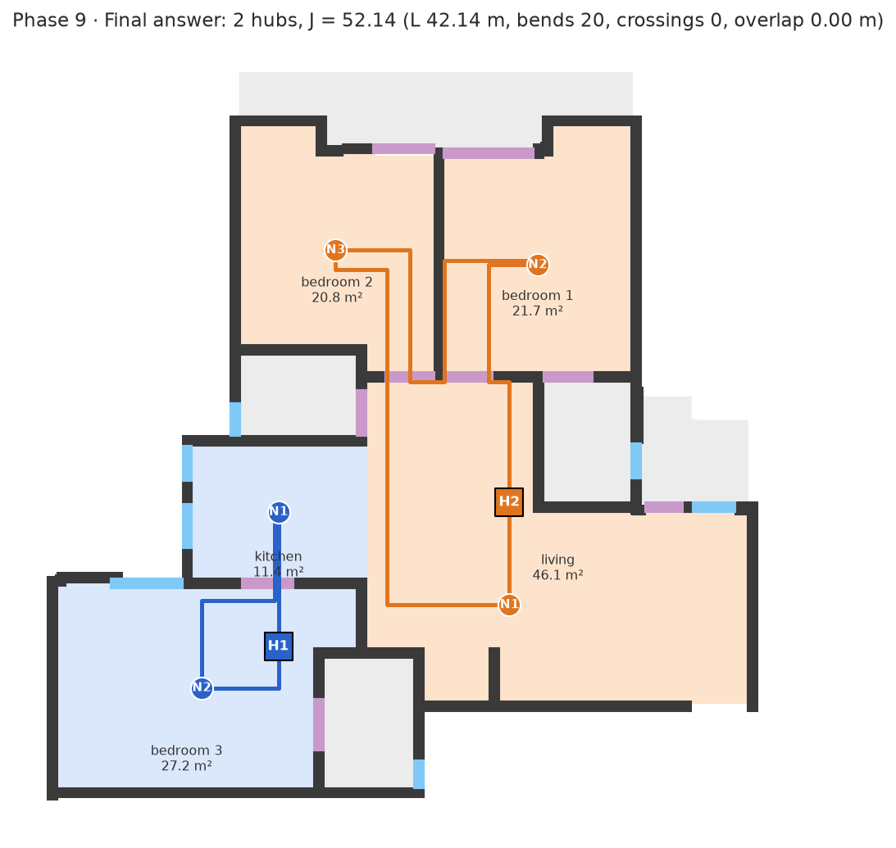
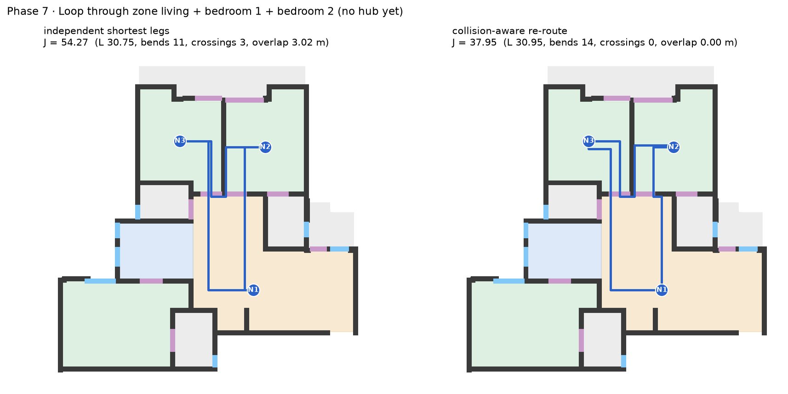

# hackhive_control_hub_loc

UR Hackathon 2026H2: joint optimisation of hub placement and closed-ring cable
routing on ResPlan floor plans. Fewest hubs wins; ties go to the lowest
J = L + 5X + O + 0.5B (cable length, crossings, overlap, bends).

**Status:** working end-to-end solver, run on all 17,000 ResPlan plans. Every
plan that the rules allow is solved and passes all 12 rule checks, except 5
tiny or broken-scale plans (see Known issues).

| Final answer for plan 10324 | Why collision-aware routing matters |
|---|---|
|  |  |
| 2 hubs (the lower bound), J = 52.14, no crossings or overlap | Same zone: separate shortest legs J = 54.27 (3 crossings) vs. our re-route J = 37.95 |

## Results on all 17,000 ResPlan plans

| | |
|---|---|
| Valid answers | **16,551 / 16,556** solvable plans (99.97%), 0 crashes, 0 timeouts |
| Unsolvable by the rules | 444: 434 have a single room over 100 m², 10 have a "room" that lies inside a wall |
| Hubs per plan | 1.77 on average; **78.5% exactly at the lower bound** max(⌈A/100⌉, ⌈n/5⌉) |
| Cost | median J 42.7; crossings in only 545 plans (661 in total) |
| Speed | median 0.14 s per plan; all 17,000 in about 9 minutes on 8 cores |

Progress over the last day:
- **Robustness:** crashes on about 0.2% of plans (broken geometry, devices inside walls) → 0.
- **Speed:** full dataset 580 s → 222 s on 8 cores (building rings only for zones that can be in a fewest-hub answer; direct hubs for one-device zones).
- **Cost:** after a finer grid, every visiting order and multi-pass rip-up-and-reroute, total J on the full dataset 755,606 → 689,099 (−8.8%), crossings 4,467 → 661, and 19 plans need one hub fewer. Solving is slower again (550 s), still 0.14 s per plan at the median.

## Key idea: devices first, hub last

Moving the hub anywhere along a finished ring leaves J unchanged. A hub on a
straight stretch splits one segment into two collinear pieces: +0 m, +0 bends,
and crossings and overlap are untouched. So the solver never searches for hub
positions. It builds the cheapest closed loop through each zone's devices,
then drops the hub on the longest straight stretch inside the allowed area.
That removes the per-point hub scan entirely, which is what makes the
full dataset run in minutes.

## How it works

A phase-by-phase walkthrough with a diagram per phase is in
[`docs/walkthrough/`](docs/walkthrough) (generated by `scripts/walkthrough.py`).

| Phase | What it does | Algorithm | Code |
|---|---|---|---|
| 1 Clean-up | Scale to metres (√(inner.area / area)), keep living / bedroom / kitchen / storage, carve rooms drawn inside other rooms, build the free space cable may use (rooms + doors − walls − exterior windows − excluded rooms), repair broken geometry | Computational geometry (Shapely) with automatic repair and retry | `hubring/plan.py` |
| 2 Devices | One device per room at its pole of inaccessibility, ≥ 0.5 m from walls and windows; narrow rooms get the best clearance that fits and are flagged | polylabel + clearance search | `hubring/plan.py` |
| 3 Grid | Axis-aligned lines only where routes need them: devices, devices ± 0.1 m, door centre + side lanes + door-frame lanes, 0.05 m inside walls, fill ≤ 1 m; only edges inside free space are kept | Non-uniform grid, merge by line priority | `hubring/grid.py` |
| 4 Room graph | Which rooms a cable can pass between, derived from the grid itself | Doorway components + direct room-to-room edges | `hubring/groups.py` |
| 5 Zones | Every connected room set within 100 m² and 5 devices; the fewest hubs H*; only zones that appear in some H*-hub cover are kept | Bitmask BFS + exact-cover DP | `hubring/groups.py` |
| 6 Legs | Cheapest route between devices counting length and bends | Dijkstra on a (grid point, heading) state graph; a turn costs 0.5 | `hubring/routing.py` |
| 7 Loop per zone | Cheapest closed loop through the zone's devices | Every visiting order ((k−1)!/2 ≤ 12) + heading DP, then collision-aware rip-up-and-reroute (≤ 4 passes, penalties double each pass, best exact J kept) | `hubring/loops.py`, `hubring/metrics.py` |
| 8 Hub | Hub in the middle of the longest straight ring stretch inside the allowed area, so it adds no cost; one-device zones get the hub 0.1 m straight out (provably optimal) | Geometry on the finished ring | `hubring/solve.py` |
| 9 Choose & check | Zones covering every room once: fewest hubs, then lowest J, then most even area; 12 hard-rule checks; JSON in metres and drawing units | Exact bitmask DP + validator | `hubring/solve.py` |

**Safety net.** Only results that pass every check are output. `solve_plan`
walks a fallback ladder (normal → next-best grouping over rule-passing rings →
safer retry with a finer grid and every order → partial, flagged) and every
geometry operation retries on a repaired copy.

### Choices where the rules leave room
- Each ring stays inside its own zone's rooms, doors and open passages; never through bathrooms, another zone, or another zone's device. So rings never meet and J adds up across zones, which keeps the DP exact.
- Devices and hubs stay ≥ 0.5 m from walls and windows; each hub stays ≥ 0.1 m from every device (team assumption, `MIN_HUB_NODE_M` in `hubring/plan.py`).
- A one-door room is entered and left on two parallel lanes through the door, so the runs don't overlap.
- Which rooms connect is computed from the geometry, because ResPlan's stored graph sometimes links rooms through solid walls.
- Data fixes: storage drawn inside another room is cut out; a "window" between two rooms is treated as a door; invalid polygons are repaired.

## Known issues
- **5 plans have no valid answer under the 0.1 m hub–device rule** (9443 has a 10 cm room; 5981–5984 are broken-scale copies where the whole flat is about 0.65 m across).
- **Narrow rooms:** about 1% of plans have a room with no point 0.5 m from the walls; the device or hub goes at the best clearance available and the plan is flagged.
- **Open questions for the organisers:** minimum hub–device distance, whether cable may pass through bathrooms, and how "inside inner" is checked on augmented plans with broken outlines.

## Setup

```bash
python3 -m venv .venv
.venv/bin/pip install -r requirements.txt
```

`data/sample300.pkl` (the first 300 plans) is committed, so the demos run as-is.
For the full 17,000-plan set, download `ResPlan.pkl` from Kaggle
(kaggle.com/datasets/resplan/resplan) into `archive (1)/`.

## Web UI (localhost)

```bash
.venv/bin/python -m uvicorn app.server:app --port 8000    # then open http://localhost:8000
```

- **Plan view:** pick a plan ID (or Random, or load a ResPlan `.pkl`) and press
  Solve. Zones, rings, hubs and devices are drawn; hover any room or ring for its
  numbers; layers switch the routing grid and room graph on. The right panel shows
  hubs vs. the lower bound, J and its parts, all 12 rule checks and one row per hub.
- **Drag a device** to a new spot: the plan re-solves on release and shows the
  change in J and hubs; positions that break a rule (outside the room, < 0.5 m from
  a wall) are refused and the device moves back. "Reset devices" restores ours.
- **Compare top 3 groupings:** the three best ways to split the rooms into hub
  zones, side by side, ranked by hubs then J (`hubring.solve.top_solutions`).
- **Show phases 0 → 9:** every phase's diagram for the current plan.
- **Photo of a floor plan:** upload a PNG/JPG; walls (auto-detected colour, or
  click a wall), doors and windows (gaps in straight walls; a gap between two
  rooms is a door, one to the outside a window) and rooms are found with OpenCV
  (`app/image_import.py`). You confirm room types and type the flat's total
  area for the scale (otherwise estimated from door widths), then press Solve.
- The solver only runs when you press **Solve**; picking a plan just selects it.
- **Batch view:** solve 100 / 500 / 1,000 / all plans on every core with live
  progress, metric tiles (valid %, hubs and share at the minimum, J, crossings,
  time per plan), a J histogram and a sortable table; click a row to open the plan.

The full `ResPlan.pkl` (if present) loads in the background; the 300-plan
sample is available at once.

## Run

```bash
.venv/bin/python scripts/run_all.py                    # solve + validate the 300-plan sample, summary
.venv/bin/python scripts/run_all.py 81 195             # specific plans; overlay + JSON in out/
.venv/bin/python scripts/walkthrough.py 10324          # one diagram per phase → out/walkthrough/
.venv/bin/python scripts/solve_parallel.py all full    # full dataset on all cores (needs ResPlan.pkl)
.venv/bin/python scripts/solve_random.py 1000 mytag    # fixed 1,000-plan benchmark (seed 11)
.venv/bin/python scripts/compare_runs.py out/solve_random_1000_a.json out/solve_random_1000_b.json
.venv/bin/python scripts/ab_variants.py 1000 name 'grid.WALL_OFFSET_M=0.1'   # A/B a setting in parallel
```

Phase demos: `scripts/phase0_demo.py` … `phase3_demo.py` (`--random 1`).
Feature scan of random plans: `scripts/edge_scan.py N`.
Plots and JSON go to `out/` (git-ignored).

`archive (1)/` holds ResPlan's own utilities (`resplan_utils.py`, MIT) and docs.

## Team

**Git Push and Pray**: Praneel Chetlapalli, Abhinav Botlaguduru, Harsha Anaparthi.
